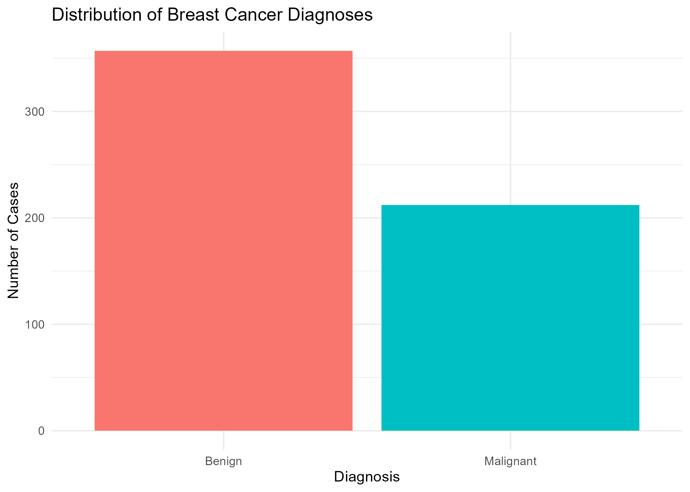
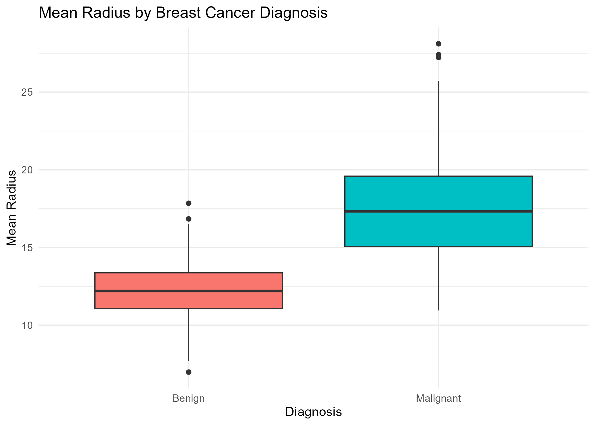
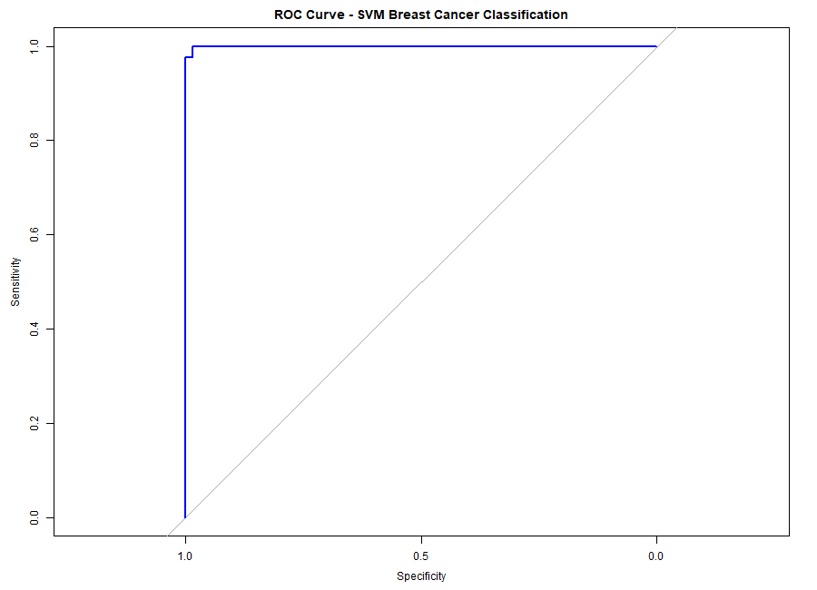

---
title: "Breast Cancer Classification Using Machine Learning"
author: "Fathima Hima"
output: html_document
---

# Abstract

Breast cancer is one of the major health challenges worldwide. Early and accurate identification of breast cancer can support timely medical decisions. This project develops a machine learning classification model to distinguish between benign and malignant breast tumours using the Wisconsin Diagnostic Breast Cancer dataset. The dataset contains 569 records and 30 numerical features extracted from digitised images of fine needle aspirates of breast masses. Data preprocessing, exploratory data analysis and Support Vector Machine (SVM) classification are performed using R. The model is evaluated using accuracy, precision, recall, specificity, F1-score and Area Under the ROC Curve (AUC). The SVM model achieved an accuracy of 98.23% and an AUC of 0.9997 on the held-out test dataset.

# 1. Introduction

Breast cancer is a disease in which abnormal cells in breast tissue grow uncontrollably. Identifying whether a tumour is benign or malignant is an important part of the diagnostic process. Benign tumours are non-cancerous, whereas malignant tumours are cancerous and may spread to other parts of the body.

Machine learning techniques can analyse medical datasets and identify patterns that may help distinguish between different diagnostic categories. Classification is a supervised machine learning task in which a model learns from labelled examples and predicts the class of new observations.

This project applies a Support Vector Machine (SVM) classification algorithm to the Wisconsin Diagnostic Breast Cancer dataset. The main objective is to predict whether a breast tumour is benign or malignant based on numerical characteristics extracted from cell nuclei.

## 1.1 Problem Statement

Accurately distinguishing benign and malignant breast tumours is an important biomedical classification problem. This project investigates whether machine learning can classify breast tumour records using numerical diagnostic features.

## 1.2 Aim

To develop and evaluate a Support Vector Machine model for classifying breast tumours as benign or malignant using the Wisconsin Diagnostic Breast Cancer dataset.

## 1.3 Objectives

- Obtain and explore a publicly available breast cancer dataset.
- Clean and preprocess the dataset using R.
- Perform exploratory data analysis and visualisation.
- Develop an SVM classification model.
- Evaluate the model using suitable classification metrics.
- Interpret the model's performance and limitations.

## 1.4 Research Question

How effectively can a Support Vector Machine classify breast tumours as benign or malignant using the numerical features in the Wisconsin Diagnostic Breast Cancer dataset?

# 2. Dataset Description

This project uses the Wisconsin Diagnostic Breast Cancer (WDBC) dataset, which is publicly available from the UCI Machine Learning Repository.

Dataset URL:

https://archive.ics.uci.edu/ml/machine-learning-databases/breast-cancer-wisconsin/wdbc.data

The dataset contains 569 observations and 32 original columns. These include an identification number, a diagnosis label and 30 numerical features.

The diagnosis column contains two categories:

- B – Benign
- M – Malignant

The numerical features describe characteristics of cell nuclei, including radius, texture, perimeter, area, smoothness, compactness, concavity and symmetry.

The dataset contains 357 benign records and 212 malignant records.

# 3. Methodology

The project follows a supervised machine learning workflow consisting of data preparation, exploratory data analysis, model development and evaluation.

## 3.1 Data Cleaning

The original dataset was imported into R. The identification column was removed because it does not provide meaningful diagnostic information for classification.

The cleaned dataset contains 569 observations and 31 columns: one diagnosis column and 30 numerical predictor features.

The dataset was checked for missing values and duplicate records. No missing values or duplicate rows were identified.

## 3.2 Exploratory Data Analysis

Exploratory data analysis was performed to understand the dataset and its characteristics.

The diagnosis distribution was examined to understand the number of benign and malignant observations. Visualisations were also created to compare the mean radius feature across the two diagnosis categories.

The analysis showed that the dataset contains more benign observations than malignant observations. The visualisations help explore differences in tumour measurements between the two groups.

## 3.3 Data Preprocessing

The diagnosis variable was converted into a categorical factor with two classes: Benign and Malignant.

The dataset was divided into training and testing sets using an 80:20 split. Stratified sampling was used to maintain the class distribution.

The training dataset contained 456 observations, while the testing dataset contained 113 observations.

Feature scaling was performed using centering and standardisation. The preprocessing parameters were calculated using only the training dataset and then applied to both training and testing datasets. This approach helps prevent data leakage.

## 3.4 Support Vector Machine

Support Vector Machine (SVM) is a supervised machine learning algorithm used for classification and regression tasks.

SVM attempts to identify a decision boundary that separates observations belonging to different classes. It uses support vectors, which are important observations located closest to the decision boundary.

This project uses an SVM with a radial basis function (RBF) kernel. The radial kernel can model nonlinear relationships between features.

The model was trained using the following settings:

- Classification type: C-classification
- Kernel: Radial
- Cost parameter: 1
- Gamma parameter: 1/30
- Probability estimation: Enabled

The trained model was used to predict the diagnosis categories of the testing observations.

# 4. Results and Evaluation

The SVM model was evaluated using the held-out testing dataset containing 113 observations.

The confusion matrix showed that 111 out of 113 observations were correctly classified, while 2 observations were incorrectly classified. The model correctly identified all 42 malignant cases in the test dataset.

### Confusion Matrix

| Actual / Predicted | Benign | Malignant |
|---|---:|---:|
| Benign | 69 | 2 |
| Malignant | 0 | 42 |

## 4.1 Performance Metrics

| Metric | Result |
|---|---:|
| Accuracy | 98.23% |
| Precision | 95.45% |
| Recall | 100.00% |
| Specificity | 97.18% |
| F1-Score | 97.67% |
| AUC | 0.9997 |

The model achieved an accuracy of 98.23%, indicating that it correctly classified most observations in the testing dataset. The recall of 100% indicates that all malignant cases in this particular test set were identified. The AUC value of 0.9997 indicates excellent discrimination between the two diagnostic classes on this test set.

# 5. Discussion

The results demonstrate that the Support Vector Machine model performed very well in classifying benign and malignant breast tumour records in the testing dataset.

The model achieved 98.23% accuracy, showing that most test observations were classified correctly. The recall of 100% indicates that all malignant cases in the test dataset were correctly identified. This is an important result because failing to identify a malignant case may have serious consequences.

The precision of 95.45% indicates that most observations predicted as malignant were actually malignant. The specificity of 97.18% also shows that the model correctly identified most benign cases.

Furthermore, the AUC value of 0.9997 indicates excellent discrimination between the two classes on this test dataset.

Overall, these findings suggest that SVM is a promising approach for this classification task. However, the results should be interpreted carefully because they are based on one train-test split.

# 6. Limitations

Although the model achieved strong performance, the project has several limitations.

- The analysis uses only one publicly available dataset.
- The evaluation uses a single 80:20 training and testing split.
- The model has not been validated using an independent clinical dataset.
- The dataset may not represent all patient populations or real-world clinical conditions.
- The model's predictions should not replace professional medical diagnosis.

Future work could investigate cross-validation, hyperparameter optimisation and testing with additional datasets to assess the reliability of the model.

# 7. Conclusion

This project developed a Support Vector Machine classification model to distinguish benign and malignant breast tumours using the Wisconsin Diagnostic Breast Cancer dataset.

The dataset was cleaned and explored using R. Feature scaling was performed before training the SVM model with a radial basis function kernel.

The model achieved 98.23% accuracy, 95.45% precision, 100% recall, 97.18% specificity, 97.67% F1-score and an AUC of 0.9997 on the held-out test dataset.

The findings demonstrate that the SVM model can effectively classify the observations in this dataset. However, further validation using additional data is necessary before considering practical clinical applications.

# 8. Reproducibility

The project was implemented using R and RStudio. The source code, dataset and generated visualisations are organised within the project repository.

To reproduce the analysis:

1. Clone or download the GitHub repository.
2. Open the RStudio project.
3. Install the required R packages if they are not already installed.
4. Run `code/analysis.R` to prepare the dataset.
5. Run `code/eda.R` to generate exploratory visualisations.
6. Run `code/svm_model.R` to train and evaluate the SVM model.

Required packages include `tidyverse`, `e1071`, `caret`, `corrplot`, `pROC` and `ggplot2`.

GitHub Repository:

https://github.com/fathima-hima/Breast-Cancer-Classification-using-Machine-Learning-in-R-Bioinformatics-

# 9. References

1. Wolberg, W. H., Street, W. N., & Mangasarian, O. L. (1995). Breast cancer Wisconsin (diagnostic) dataset. UCI Machine Learning Repository.

2. Cortes, C., & Vapnik, V. (1995). Support-vector networks. Machine Learning, 20, 273–297.

3. R Core Team. R: A language and environment for statistical computing. R Foundation for Statistical Computing. https://www.r-project.org/

4. Meyer, D., Dimitriadou, E., Hornik, K., Weingessel, A., & Leisch, F. (2024). e1071: Misc Functions of the Department of Statistics, Probability Theory Group (Formerly: E1071), TU Wien. R package.

